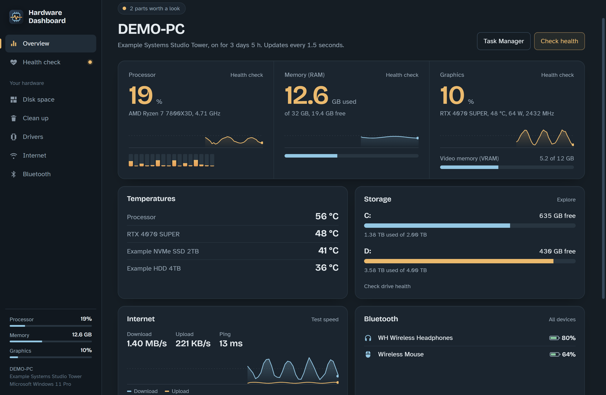
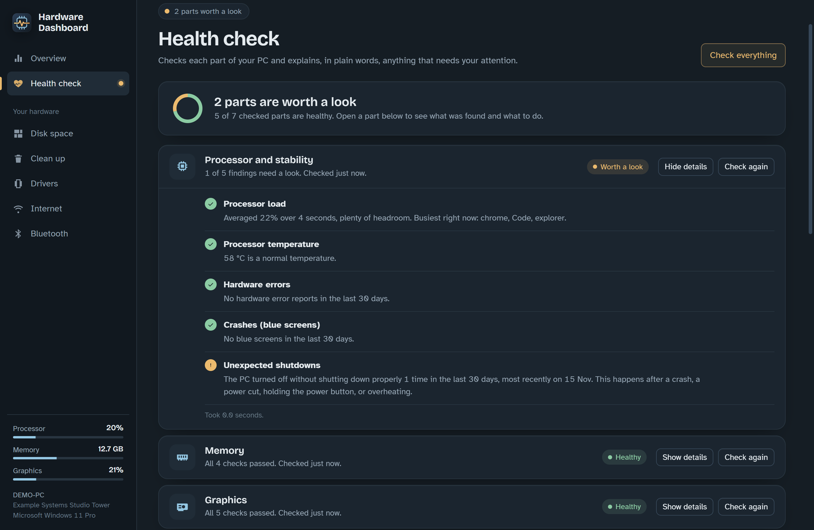
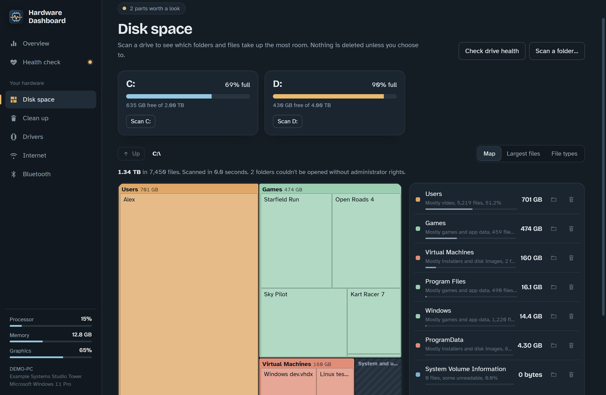
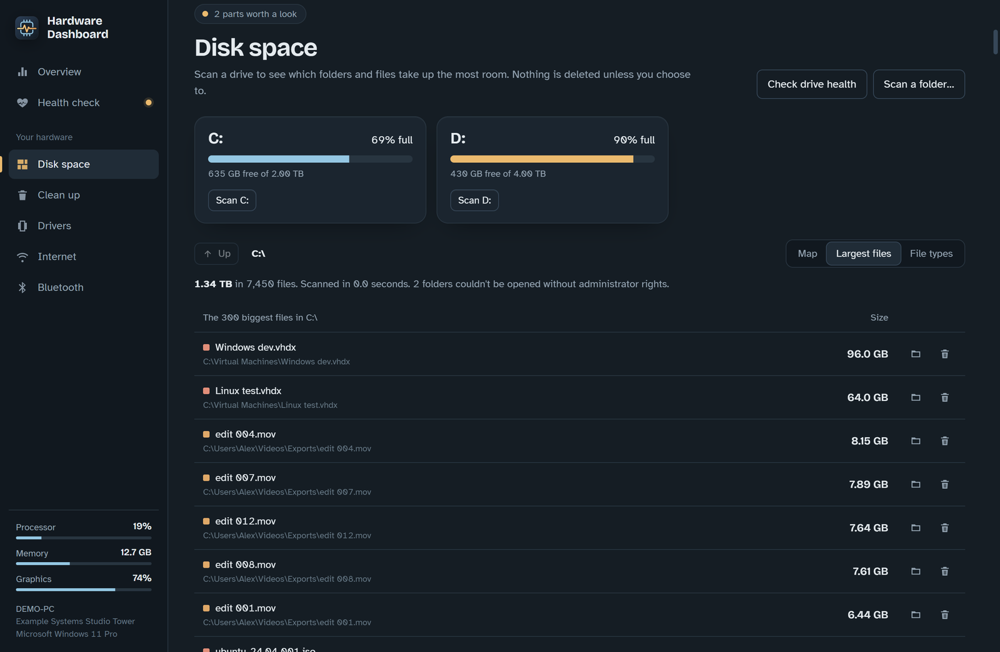
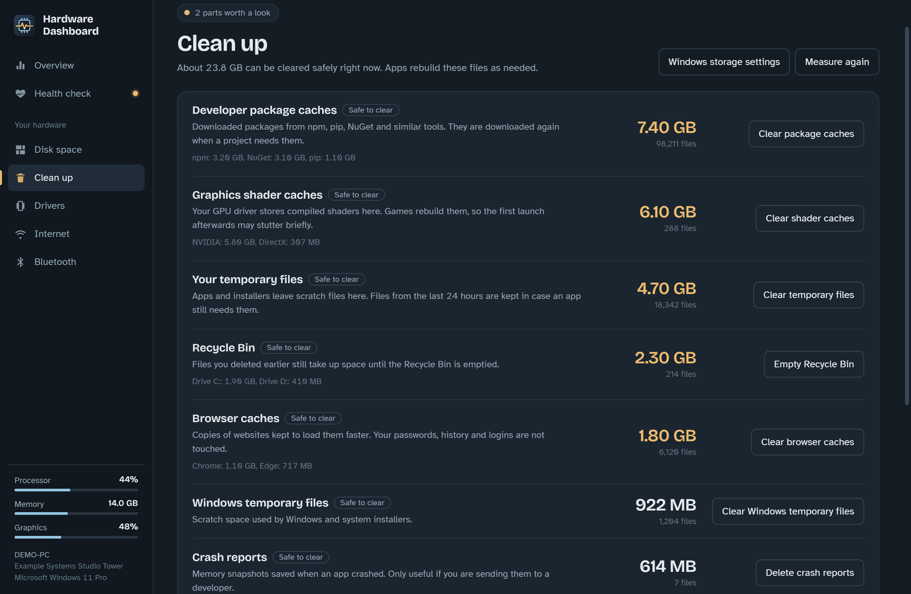
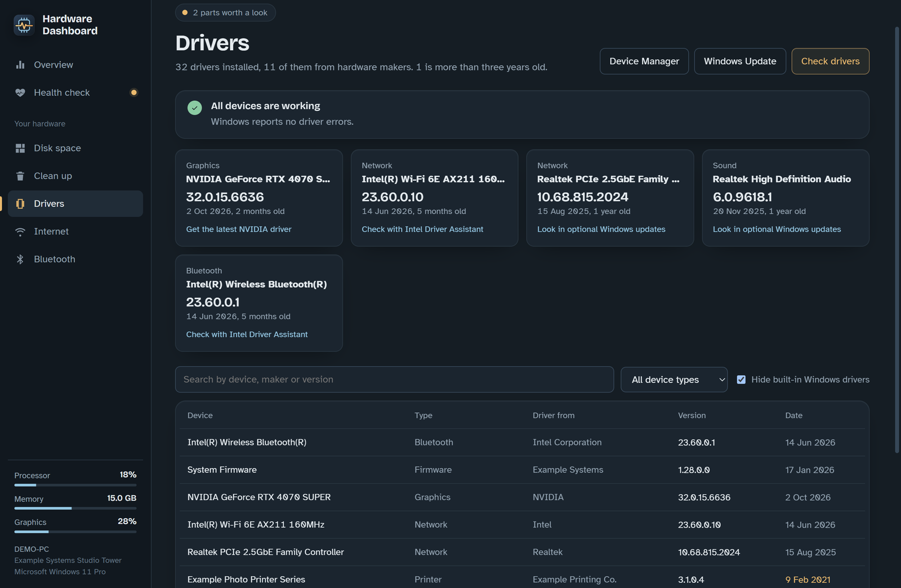
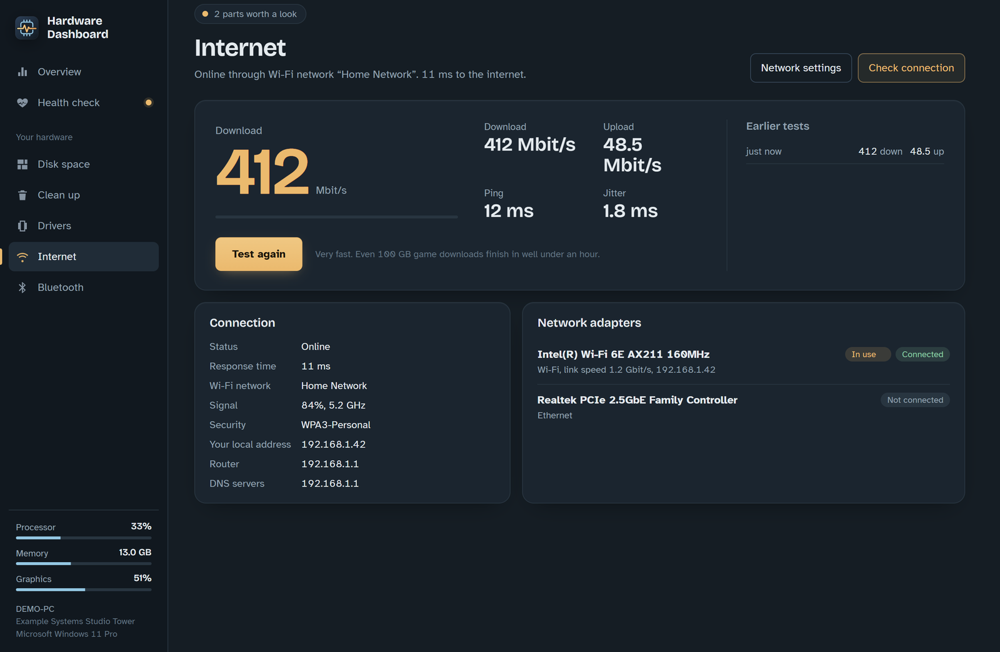
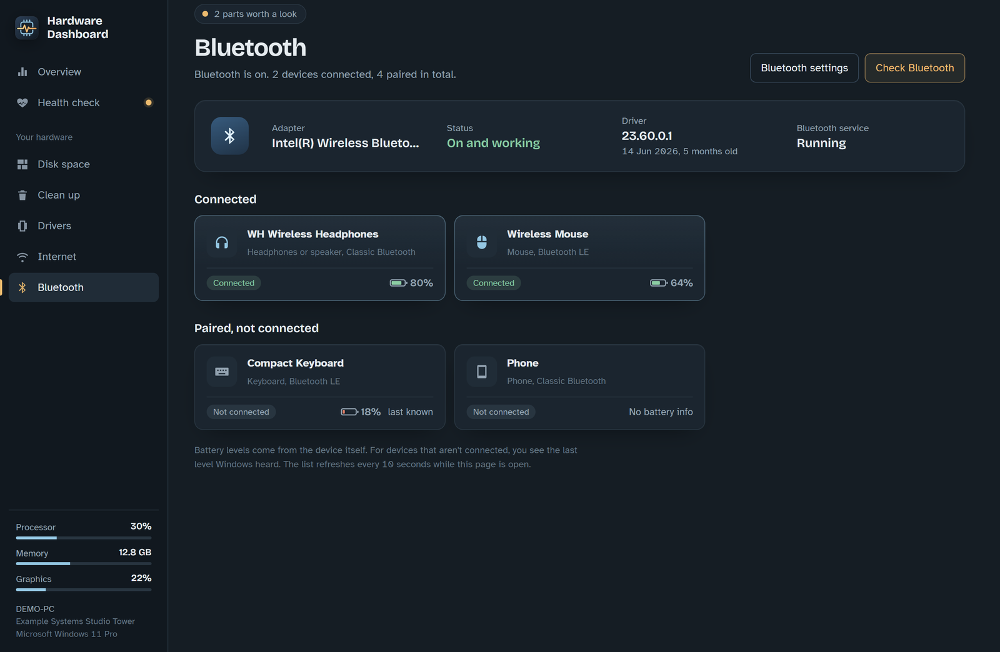
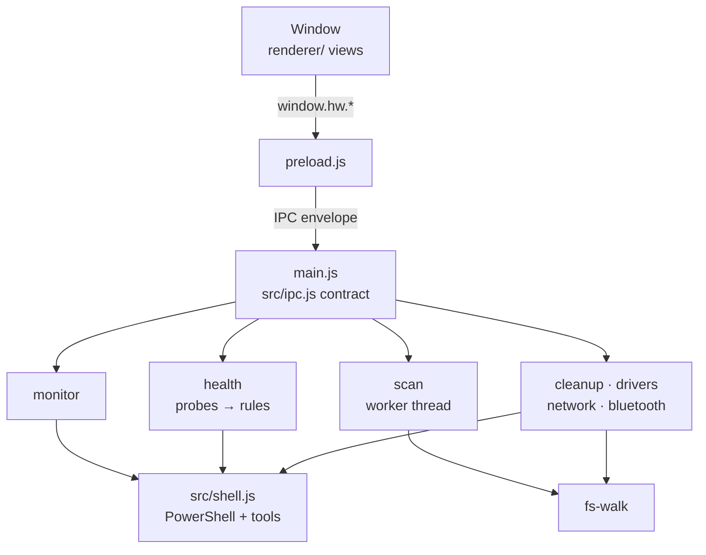

# Hardware Dashboard

A Windows desktop app that shows live hardware readings, checks each part
of the PC for problems, and finds where your disk space went.

[](https://github.com/Andreas-Erick/hardware-dashboard/actions/workflows/test.yml)


[](LICENSE)

Built with Electron and plain JavaScript (no build step). It runs entirely
on your PC: no account and no telemetry. The only network traffic is a
small ping to 1.1.1.1 and 8.8.8.8 for response time, and the speed test
you start yourself.



<sub>Screenshots use the built-in demo mode, so every value is made up.</sub>

## Start it

On a new machine, double-click **`Start Hardware Dashboard.cmd`** once.
It installs the dependencies and adds Desktop and Start Menu shortcuts.
After that, use the **Hardware Dashboard** shortcut.

From a terminal (Node.js 20 or newer):

```powershell
npm install
npm start        # open the app
npm run demo     # open it on a made-up PC
npm test         # behaviour tests, no Windows tools needed
npm run check    # smoke-test the data layer on this PC
```

<details>
<summary>Shortcuts and icon</summary>

Recreate the shortcuts:

```powershell
powershell -ExecutionPolicy Bypass `
  -File scripts\install-shortcuts.ps1
```

The logo is `renderer/logo.svg`. Rebuild the icon with
`npx electron scripts/make-icon.js`.

</details>

<details>
<summary>Demo mode and screenshots</summary>

`npm run demo` (or `HD_DEMO=1`) runs the app on an invented PC from
`src/demo.js`. Only the data sources are replaced: the health rules, the
disk scan engine and the interface run unchanged. It uses its own
profile, so none of your history shows up.

To refresh the screenshots, set `HD_CAPTURE` to a folder. The app opens
every page, saves a screenshot of each, then quits:

```powershell
$env:HD_DEMO = 1; $env:HD_CAPTURE = "$PWD\shots"
npx electron .
```

</details>

## What it shows

| Page | What you get |
| --- | --- |
| **Overview** | Live CPU load (overall and per core), RAM, GPU load, VRAM, GPU power and clock, temperatures, drive fill levels, download/upload rate, ping, and the hardware inside the PC. |
| **Disk space** | Scan a drive or folder and explore it as a map where tile size is disk space, coloured by what fills each folder. Drill in, see the 300 largest files or a breakdown by file type, show an item in Explorer or move it to the Recycle Bin. |
| **Clean up** | Measures the usual space hogs: Recycle Bin, temp files, shader and browser caches, developer caches, crash reports, Downloads, Windows Update leftovers, hibernation and page file. Caches clear in one click. |
| **Drivers** | Devices with problems, your key drivers (graphics, network, sound, Bluetooth) with their age and where to update them, and a searchable list of every driver. |
| **Internet** | Online status, Wi-Fi network and signal, addresses, router, DNS, adapters, and a speed test (download, upload, ping, jitter) with history. |
| **Bluetooth** | Adapter, radio, driver, the Bluetooth service, and paired devices with connection state and battery level. |
| **Health check** | One check per part. Each finding says what was found and what to do, with a button to the right Windows tool. |

<details>
<summary>Screenshots of every page</summary>

**Health check**



**Disk space**





**Clean up**



**Drivers**



**Internet**



**Bluetooth**



</details>

<details>
<summary>What the health checks look at</summary>

- **Processor and stability:** load over 4 s and the busiest apps,
  temperature, corrected hardware errors (WHEA), blue screens and
  unexpected shutdowns in the last 30 days.
- **Memory:** usage and top apps, page file, module match and speed, the
  last Windows Memory Diagnostic result.
- **Graphics:** temperature, VRAM, active performance limits (heat or
  power), driver age, driver crashes in the last 30 days.
- **Storage:** Windows drive health, SSD wear and temperature
  (administrator), free space, disk and file system errors, TRIM.
- **Battery:** capacity compared with new, charge cycles, charging state,
  the full Windows battery report.
- **Internet:** connection, DNS, response time, jitter, lost connections,
  Wi-Fi signal and band.
- **Bluetooth:** adapter status, radio, service, devices with problems,
  low batteries.
- **Drivers:** devices with errors, important drivers older than three
  years, unsigned drivers.

</details>

## Goals and non-goals

**Goals**

- Explain the PC in plain words to someone who isn't technical. Every
  finding says what to do next.
- Stay light while watching: the 1.5 s live tick never starts PowerShell,
  and polling stops while the window is hidden.
- Never lose data by accident. Deleting always needs confirmation, items
  go to the Recycle Bin, and system folders are refused.
- Work from a fresh clone with one double-click.

**Non-goals**

- macOS or Linux. The data comes from Windows tools (CIM, PowerShell,
  `netstat`, `nvidia-smi`), and abstracting them away would hide what
  makes the readings reliable.
- Tuning, overclocking or fan control. The app reads, it doesn't write
  hardware settings.
- Background monitoring, alerts or history beyond speed test results.
- Live GPU stats for non-NVIDIA cards. There is no vendor-neutral source
  on Windows that doesn't need a driver SDK.

## Safety

- Nothing is deleted unless you confirm it.
- Items from the disk map go to the **Recycle Bin**, so you can restore
  them. Windows, Program Files, ProgramData, your user folder itself and
  drive roots are refused, and nothing can be removed while a scan runs.
- Clean up can only empty a fixed list of cache folders. Temp files newer
  than 24 hours and files in use are skipped.

## Good to know

- **CPU and SSD temperatures** are only shared with programs running as
  administrator. Use "Restart as administrator" on the Overview page.
  Some laptops don't expose a CPU sensor at all.
- **Live GPU stats** come from `nvidia-smi`, so they need an NVIDIA GPU.
- The **speed test** uses Cloudflare's public servers
  (speed.cloudflare.com) and transfers roughly 100–400 MB.
- A drive scan can show **more** than the space used (hard-linked system
  files, cloud-only OneDrive files) or **less** (folders that need
  administrator rights). The map shows the gap as a striped
  "System and unreadable files" tile.

## Architecture



Dependencies point down. The window only knows `window.hw`. Domain
modules never import Electron: `main.js` hands them what they need
(`trashItem`, `getDrives`), and tests hand them fakes instead.

### Key decisions

| ADR | Decision | Trade-off |
| --- | --- | --- |
| [0001](docs/adr/0001-one-declared-ipc-contract.md) | Main declares the IPC contract once; preload builds `window.hw` from it | No static types across the boundary |
| [0002](docs/adr/0002-disk-scan-in-a-worker-behind-a-message-engine.md) | Disk scan runs in a worker behind a message engine | Every query is an async round trip |
| [0003](docs/adr/0003-live-snapshot-never-starts-powershell.md) | Live tick uses only cheap sources; slow ones get their own clock | Memory "used" differs slightly from Task Manager |
| [0004](docs/adr/0004-plain-javascript-no-build-step.md) | Plain JavaScript, no framework or bundler | Page scripts share one global scope |

### Adding a health check

A check is a **probe** (facts from Windows) plus a **rule** (facts to
findings). Rules are pure, so they are tested with plain objects:

1. Add `{ id, name, desc }` to `CHECKS` in `src/health/index.js`.
2. Add `async <id>()` to `createProbes` in `src/health/probes.js`.
3. Add `<id>(facts)` to `src/health/rules.js`. It returns findings,
   `{ status, label, detail, fix?, action? }`.
4. Add cases to `test/health-thresholds.test.js`.

The Health page picks it up from `healthChecks()` with no UI change.

## Project layout

```text
main.js            Electron main: declares the window's API
preload.js         Builds window.hw from that contract
src/
  ipc.js           Contract + { ok, value | error } envelope
  shell.js         PowerShell and Windows tools, typed failures
  monitor.js       Live snapshot and hardware inventory
  drivers.js       Installed drivers and problem devices
  network.js       Connection info and the speed test
  net-probe.js     TCP ping and latency statistics
  bluetooth.js     Adapter, radio, paired devices (+ .ps1)
  cleanup.js       Each item measures and clears itself
  demo.js          Made-up PC for demo mode (HD_DEMO=1)
  mem-fs.js        In-memory filesystem (tests, demo)
  fs-walk.js       Folder walk for the scan and Clean up
  scan/            index.js (module), tree.js (pure),
                   engine.js, worker / in-process adapters,
                   trash-guard.js (Recycle Bin rules)
  health/          probes.js (facts) + rules.js (findings)
shared/            Rules used by both main and the page
renderer/
  core.js          Helpers, navigation, modal, toasts
  views/           One file per page: { enter, leave }
  app.js           Starts the dashboard
test/              npm test: in-memory fs, recorded output
scripts/           smoke test, icon, shortcuts
docs/adr/          Architecture decision records
docs/screenshots/  README images, taken in demo mode
```

The words the code and the interface use are in
[GLOSSARY.md](GLOSSARY.md).

## License

[MIT](LICENSE)
